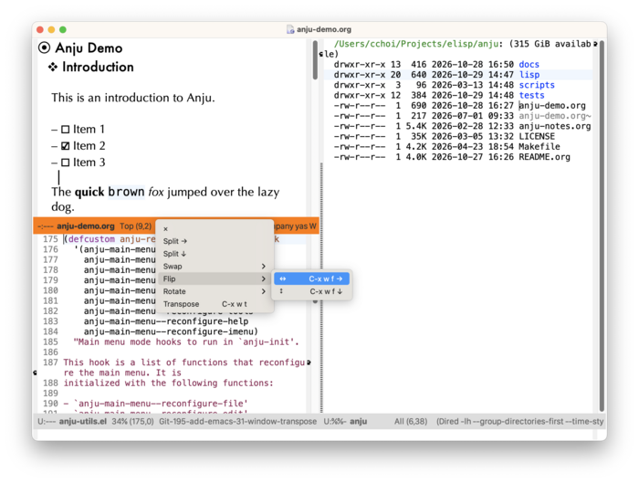

[[https://melpa.org/#/anju][file:https://melpa.org/packages/anju-badge.svg]] [[https://stable.melpa.org/#/anju][file:https://stable.melpa.org/packages/anju-badge.svg]]
* Anju (안주)
:PROPERTIES:
:CUSTOM_ID: anju-안주
:END:

Anju is a project to align mouse interactions in Emacs with contemporary (circa 2026) expectations. Effort towards this alignment is made in the following areas:

- Context-sensitive menus
- De-emphasis of middle mouse button usage (binding =<mouse-2>=) and remove secondary selection
- Support direct manipulation when possible
- Re-organization of the main menu bar

The features offered by Anju are opinionated, but avoids unconventional behavior. Anju aspires to bring a calmer mouse experience to Emacs.

Please note that all UI terminology in this document is Emacs-centric and differs from conventional GUI terminology. Refer to [[https://www.gnu.org/software/emacs/manual/html_node/emacs/Frames.html][Frames (GNU Emacs Manual)]] for more detail on this.

* Features
:PROPERTIES:
:CUSTOM_ID: features
:END:

Anju offers many enhancements to the mouse interactions provided by Emacs. These enhancements are organized to the following areas below:

- Mode Line
- Context Menu
- Main Menu
- Emacs Window Management

Some screenshots to demo Anju's offerings are shown below.
  
[[file:docs/images/anju-mode-line-buffer-list.png]]

On the mode line, left-click (~mouse-1~) on the buffer name to raise a pop-up menu containing a list of open buffers. The contents of this list is controlled by the customizable variable ~anju-buffer-list-filter-functions~.

A right-click (~mouse-3~) on any blank space on the mode line will pop-up a window management menu.

From here, one can:
- Delete the window (×)
- Split the window horizontally (→)
- Split the window vertically (↓)
- If multiple windows are shown, swap the current window.

Shown below is an screenshot of a context menu when text is selected.

[[file:docs/images/anju-context-menu-region.png]]

More detail on Anju's features can be found in the [[https://kickingvegas.github.io/anju/Features.html][Anju User Guide]].

* Requirements
:PROPERTIES:
:CUSTOM_ID: requirements
:END:
Anju requires Emacs 29.1+, Casual 2.13+, Markdown Mode 2.7+.

Certain menus require more installed software:

- Anju Dired Support: GNU Coreutils (~ls~)
- Markdown import to Org: pandoc

Anju provides optional support for Magit 4.4+.
    

* Install
:PROPERTIES:
:CUSTOM_ID: install
:END:

To install Anju, add the command ~anju-init~ to your Emacs initialization file.

#+begin_src elisp :lexical no
  (anju-init)
#+end_src

This command will initialize ~context-menu-mode~ and reconfigure the following mouse menus and bindings:

- Legacy mouse bindings
- Mode line bindings
- Main menu
- Context menus for different modes

The ~anju-init~ command can be customized to preference. Read more on this in the [[https://kickingvegas.github.io/anju/Install.html][Anju User Guide]].

* Future Work
:PROPERTIES:
:CUSTOM_ID: future-work
:END:

Work on Anju is on-going. Plans for future enhancements include:

- Support for more built-in modes
- Further changes to the main menu

Although much consideration on both the user and developer experience has been made, they are both subject to change in future releases if a better approach presents itself.
    
* Sponsorship
:PROPERTIES:
:CUSTOM_ID: sponsorship
:END:
It costs money to make, enhance, and maintain Anju as ideologically free software. If you enjoy using Anju, please buy me a coffee to help support its development and maintenance.

[[https://www.buymeacoffee.com/kickingvegas][file:docs/images/default-yellow.png]]

* Acknowledgments
:PROPERTIES:
:CUSTOM_ID: acknowledgments
:END:

Thanks goes out to the contributors to ~mouse.el~, whose work this package builds upon.

#+HTML: 
© 2026 Charles Y. Choi

